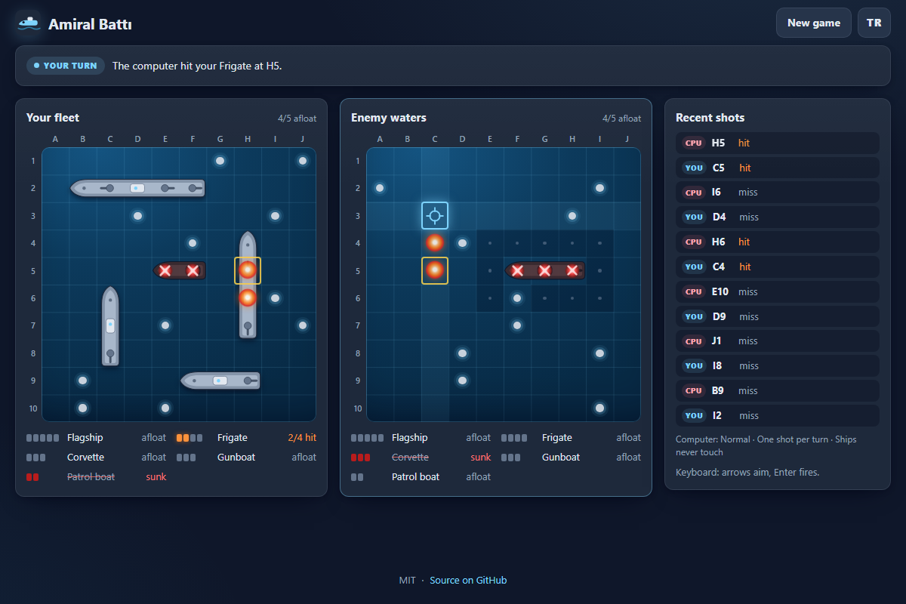

# Amiral Battı - hide your fleet, outguess the computer, sink its ships

[](#tests)
[](LICENSE)

**▶ Play now: https://celaldrg.github.io/amiral-batti/**



Amiral Battı is a small sea battle game for the browser. Place five ships on your 10×10 sea, then take turns firing at the computer's hidden fleet. The first side to sink every enemy ship wins.

## Features

- **Fleet setup your way:** drag ships from the harbor onto your sea, or pick one and tap a cell. A live preview shows where the ship will go and turns red where it cannot. Rotate, Random and Clear buttons are there too.
- **Five ships** drawn as rounded hulls: Flagship (5), Frigate (4), Corvette (3), Gunboat (3) and Patrol boat (2).
- **Three computer levels:** Easy fires at random, Normal hunts around its hits and follows the line, Hard weighs every spot your remaining ships could still be in.
- **Optional rules:** salvo (each turn, one shot per ship still afloat, for both sides) and whether ships may touch. By default they may not, not even at a corner.
- **Readable battles:** splash, explosion and sinking animations, a log of recent shots, and fleet lists with a pip for every hit. When ships may not touch, the water around a sunk ship is shaded.
- **Picks up where you left off:** a battle in progress survives a reload, and your win/loss record is kept in the browser.
- **English and Turkish**, switchable at any time. The choice is remembered.
- **Mobile first:** fully playable on a 375 px wide phone by touch, and from the keyboard on desktop. Every cell has a screen-reader label, and the animations calm down when the system asks for reduced motion.
- **No dependencies:** plain HTML, CSS and JavaScript modules, no build step and no network requests.

## How to play

**Touch or mouse**

1. **Setup.** Drag a ship from the harbor onto your sea, or tap it in the harbor and then tap a cell. Tap a placed ship to select it and tap it again to rotate it. Drag a placed ship to move it, or drag it off the sea to send it back to the harbor. *Random* places the whole fleet and *Clear* empties the sea.
2. **Settings.** Before you press *Start*, pick the computer level and switch salvo or touching ships on or off.
3. **Battle.** Tap a cell in the enemy waters to fire. A splash is a miss and an explosion is a hit. A sunk ship shows its hull. Then the computer fires back at your fleet.
4. **New game.** During a battle the button asks for a second press, so a stray tap cannot throw a game away.

**Keyboard**

| Phase | Keys |
| --- | --- |
| Setup | `1`–`5` pick a ship, arrow keys move the cursor, `Enter` or `Space` places, `R` rotates, `Delete` removes, `Esc` deselects |
| Battle | Arrow keys aim, `Enter` or `Space` fires |

The arrow keys work right away. They focus the right board for you, and `Tab` reaches every button.

## Run locally

The game is a static site, so any static file server works. Run it from the repository folder:

```sh
npx serve .
```

Then open the address it prints. ES modules need `http://`. Opening `index.html` straight from disk (`file://`) does not work. Add `?demo` to the address to see the fixed mid-battle position used for the screenshot.

## Tests

```sh
node --test
```

The tests need Node.js 22 or newer and nothing else. GitHub Actions runs the same command on every push and pull request. The game logic lives in pure modules with a seeded random generator, so every test is deterministic. The suite covers:

- **Fleet and placement:** ship geometry, sea bounds, overlap and touching rules, and seeded random fleets.
- **Game flow:** setup, turns, hits, misses and sinking, the salvo rule, wins for either side, and replaying a game from its history.
- **Computer:** it never repeats a cell, and seeded games keep the levels in order (hard beats normal beats easy). Normal and hard follow a line of hits.
- **Saves and statistics:** restoring a battle after a reload, rejecting damaged saves, accuracy and the record.
- **Storage:** the `localStorage` helper never throws, not even when storage is blocked.
- **Interface helpers:** cell names, the keyboard cursor and pointer placement.
- **Translations:** both languages have the same keys and parameters, and every key the page uses exists.
- **Demo:** the `?demo` position.

## Project structure

```text
index.html          page shell, meta tags and favicon
style.css           dark theme, responsive layout, animations
src/
  game.js           rules: setup, turns, salvo, result (pure)
  fleet.js          ships, placement checks, random fleets (pure)
  board.js          marks, hits and sinking (pure)
  ai.js             computer opponents: easy, normal, hard (pure)
  rng.js            seeded random numbers (pure)
  session.js        saves, statistics, record (pure)
  coords.js         cell names, cursor and pointer helpers (pure)
  demo.js           fixed mid-battle position for ?demo (pure)
  i18n.js           English and Turkish strings (pure)
  storage.js        localStorage wrapped in try/catch
  main.js           UI: wiring, rendering, turns, input
  setup.js          UI: fleet placement by drag, tap and keyboard
  board-view.js     UI: board grid, ships and effects
  panels.js         UI: fleet lists and shot log
  hull.js, dom.js   UI: SVG hulls and small DOM helpers
test/               node:test suites
docs/screenshot.png
```

## License

[MIT](LICENSE) © 2026 Celalettin Durgaç

## Türkçe

**▶ Hemen oyna: https://celaldrg.github.io/amiral-batti/**

Amiral Battı, tarayıcıda oynanan küçük bir deniz savaşı oyunu. Beş gemini 10×10 denizine yerleştirirsin, sonra sırayla bilgisayarın gizli filosuna ateş edersiniz. Karşı tarafın bütün gemilerini ilk batıran kazanır.

### Özellikler

- **İstediğin gibi yerleştir:** gemileri limandan denizine sürükle ya da birini seçip bir kareye dokun. Önizleme geminin nereye geleceğini gösterir, sığmadığı yerde kırmızıya döner. Döndür, Rastgele ve Temizle düğmeleri de var.
- **Beş gemi**, yuvarlak gövdelerle çizilir: Amiral gemisi (5), Fırkateyn (4), Korvet (3), Gambot (3) ve Karakol botu (2).
- **Üç bilgisayar seviyesi:** Kolay rastgele ateş eder. Normal vurduğu yerin çevresini tarar ve çizgiyi izler. Zor, kalan gemilerinin olabileceği her konumu hesaba katar.
- **İsteğe bağlı kurallar:** salvo (her tur, batmamış her gemi için bir atış, iki taraf için de) ve gemilerin birbirine değip değemeyeceği. Varsayılan olarak değemezler, köşeden bile.
- **Okunaklı savaş:** su sıçraması, patlama ve batma animasyonları, son atışlar listesi ve her isabet için bir nokta gösteren filo listeleri. Gemiler birbirine değemiyorsa batan geminin çevresindeki su işaretlenir.
- **Kaldığın yerden devam:** süren savaş sayfa yenilenince kaybolmaz, galibiyet ve yenilgi sayın tarayıcıda saklanır.
- **İngilizce ve Türkçe**, istediğin an değiştirilir. Seçim hatırlanır.
- **Önce mobil:** 375 px genişliğindeki telefonda dokunarak, masaüstünde klavyeyle tam oynanır. Her karenin ekran okuyucu etiketi var. Sistem azaltılmış hareket isterse animasyonlar sakinleşir.
- **Bağımlılık yok:** düz HTML, CSS ve JavaScript modülleri. Derleme adımı ve ağ isteği yok.

### Nasıl oynanır

**Dokunma ya da fare**

1. **Hazırlık.** Bir gemiyi limandan denizine sürükle ya da limanda ona dokunup sonra bir kareye dokun. Yerleşmiş bir gemiye dokunursan seçilir, yeniden dokunursan döner. Sürükleyerek taşıyabilirsin. Denizin dışına sürüklersen limana geri döner. *Rastgele* bütün filoyu yerleştirir, *Temizle* denizi boşaltır.
2. **Ayarlar.** *Başla*'ya basmadan önce bilgisayar seviyesini seç, salvoyu ve gemilerin değmesini aç ya da kapat.
3. **Savaş.** Düşman sularında bir kareye dokunarak ateş et. Su sıçraması ıska, patlama isabet demek. Batan geminin gövdesi görünür. Sonra bilgisayar senin filona ateş eder.
4. **Yeni oyun.** Savaş sürerken düğme ikinci kez basılmasını ister, böylece yanlışlıkla oyun kaybolmaz.

**Klavye**

| Aşama | Tuşlar |
| --- | --- |
| Hazırlık | `1`–`5` gemi seçer, ok tuşları imleci taşır, `Enter` ya da `Space` yerleştirir, `R` döndürür, `Delete` kaldırır, `Esc` seçimi bırakır |
| Savaş | Ok tuşları nişan alır, `Enter` ya da `Space` ateş eder |

Ok tuşları hemen çalışır, doğru tahtaya odağı kendileri taşır. Her düğmeye `Tab` ile ulaşılır.

### Yerelde çalıştırma

Oyun statik bir site, herhangi bir statik dosya sunucusu yeter. Depo klasöründe şunu çalıştır:

```sh
npx serve .
```

Sonra yazdığı adresi aç. ES modülleri `http://` ister. `index.html`'i doğrudan diskten (`file://`) açmak çalışmaz. Ekran görüntüsündeki sabit savaş anını görmek için adrese `?demo` ekle.

### Testler

```sh
node --test
```

Testler için yalnızca Node.js 22 ya da daha yenisi gerekir. GitHub Actions her push ve pull request'te aynı komutu çalıştırır. Oyun mantığı tohumlu rastgele sayı üreteci kullanan saf modüllerde. Bu yüzden her test her seferinde aynı sonucu verir. Kapsam:

- **Filo ve yerleşim:** gemi geometrisi, deniz sınırları, üst üste binme ve değme kuralları, tohumlu rastgele filolar.
- **Oyun akışı:** hazırlık, sıra, ıska, isabet ve batma, salvo kuralı, iki tarafın da kazanması ve oyunun geçmişinden yeniden oynatılması.
- **Bilgisayar:** aynı kareye iki kez ateş etmez. Tohumlu oyunlarda seviyeler sırasını korur (zor normali, normal kolayı geçer). Normal ve zor seviye isabet çizgisini izler.
- **Kayıt ve istatistik:** yenilemeden sonra savaşın geri gelmesi, bozuk kayıtların reddi, isabet oranı ve skor.
- **Depolama:** `localStorage` yardımcısı depolama engelli olsa bile hata fırlatmaz.
- **Arayüz yardımcıları:** kare adları, klavye imleci ve işaretçiyle yerleştirme.
- **Çeviriler:** iki dilde aynı anahtarlar ve parametreler var, sayfanın kullandığı her anahtar tanımlı.
- **Demo:** `?demo` konumu.

### Proje yapısı

```text
index.html          sayfa iskeleti, meta etiketleri ve simge
style.css           koyu tema, duyarlı düzen, animasyonlar
src/
  game.js           kurallar: hazırlık, sıra, salvo, sonuç (saf)
  fleet.js          gemiler, yerleşim denetimi, rastgele filolar (saf)
  board.js          işaretler, isabetler ve batma (saf)
  ai.js             bilgisayar rakipler: kolay, normal, zor (saf)
  rng.js            tohumlu rastgele sayılar (saf)
  session.js        kayıt, istatistik, rekor (saf)
  coords.js         kare adları, imleç ve işaretçi yardımcıları (saf)
  demo.js           ?demo için sabit savaş anı (saf)
  i18n.js           İngilizce ve Türkçe metinler (saf)
  storage.js        try/catch ile sarılmış localStorage
  main.js           arayüz: bağlantılar, çizim, sıralar, girdi
  setup.js          arayüz: sürükleme, dokunma ve klavyeyle yerleşim
  board-view.js     arayüz: deniz ızgarası, gemiler ve efektler
  panels.js         arayüz: filo listeleri ve atış kaydı
  hull.js, dom.js   arayüz: SVG gövdeler ve küçük DOM yardımcıları
test/               node:test test dosyaları
docs/screenshot.png
```

### Lisans

[MIT](LICENSE) © 2026 Celalettin Durgaç
